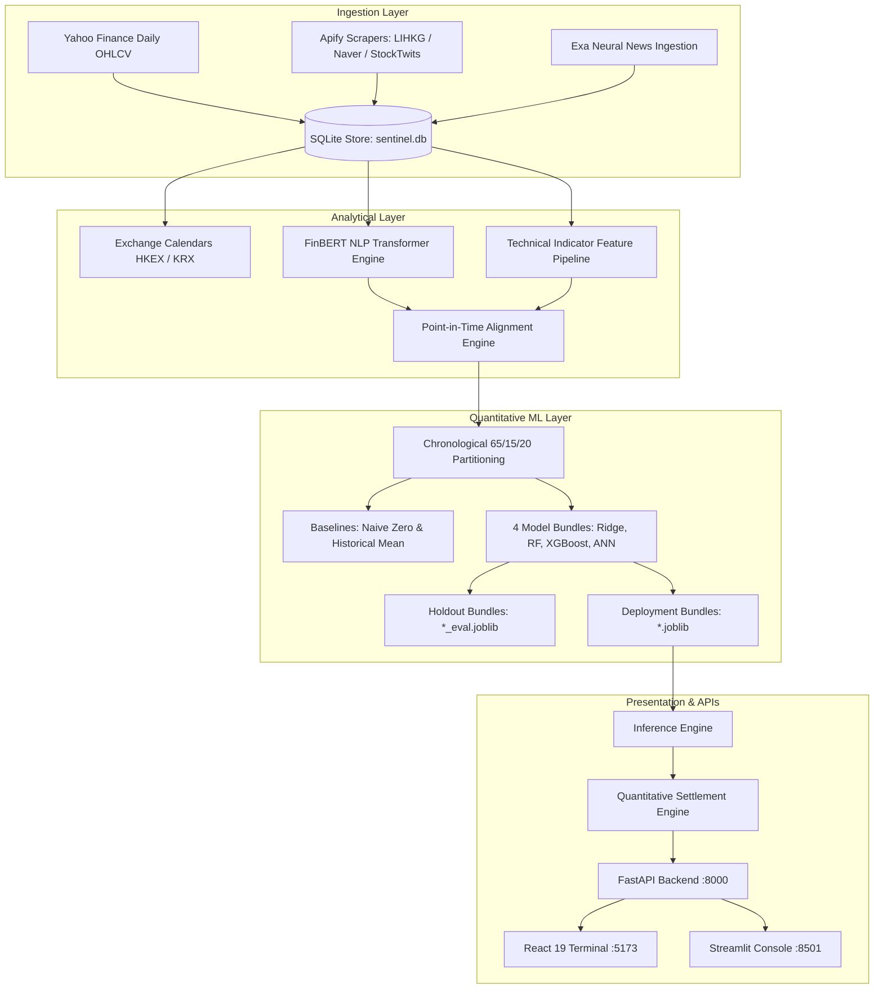

# SENTINEL.AI — Quantitative Intelligence & ML Systems Terminal

[](https://fastapi.tiangolo.com)
[](https://react.dev)
[](https://www.typescriptlang.org)
[](https://vitejs.dev)
[](https://tailwindcss.com)
[](https://python.org)
[](https://huggingface.co/ProsusAI/finbert)

**SENTINEL.AI** is a financial sentiment intelligence and quantitative predictive analytics terminal designed for equities across the **Hong Kong Stock Exchange (HKEX)** and the **Korea Exchange (KRX)**.

The platform integrates institutional financial news ingestion (via Exa), retail discourse streams, transformer-based financial sentiment inference (`ProsusAI/finbert`), multi-timescale technical indicator feature engineering, and four machine learning architectures (Ridge, Random Forest, XGBoost, ANN MLP) evaluated through strict chronological walk-forward cross-validation.

---

## Key Capabilities

- **Equities Coverage**: 10 monitored assets across HKEX (`0700.HK`, `9988.HK`, `1299.HK`, `0005.HK`, `3690.HK`) and KRX (`005930.KS`, `000660.KS`, `373220.KS`, `005380.KS`, `035420.KS`).
- **Transformer NLP**: Local CPU/GPU inference via `ProsusAI/finbert` producing normalized probabilities (positive, negative, neutral) and confidence-weighted scores.
- **Strict Temporal Hygiene**: Zero forward-looking leakage. Sentiment scores and technical features join strictly on $t_{\text{published}} \le t_{\text{bar}}$, and a dual-boundary lookback filter excludes undated or future-dated records.
- **Quantitative ML Suite**: 40 trained model bundles evaluated on an untouched chronological holdout partition (65% train / 15% validation / 20% test).
- **Execution & Analytics Interfaces**: Dual-delivery system with a React 19 quantitative terminal (`frontend-web`) and a Streamlit operational console (`frontend/app.py`).

---

## Architecture Overview



---

## Assessment Coverage Summary

| Requirement | Implementation Status | Verified Evidence |
|---|---|---|
| **HKEX 5 Equities** | **Verified** | 632 daily OHLCV bars across `0700.HK`, `9988.HK`, `1299.HK`, `0005.HK`, `3690.HK`. |
| **KRX 5 Equities** | **Verified** | 615 daily OHLCV bars across `005930.KS`, `000660.KS`, `373220.KS`, `005380.KS`, `035420.KS`. |
| **FinBERT NLP Engine** | **Verified** | Local Hugging Face transformer pipeline; 355 sentiment scores calculated in `sentiment_scores`. |
| **2 Listed Social Sources / Exch.** | **Partially Demonstrated** | Code implemented & mocked for LIHKG, Naver, AAStocks, Blind. In database: LIHKG (2 posts) & Naver (12 posts) demonstrated with FinBERT scores; StockTwits (153 posts) serves as supplemental stream. Additional eligible-source live volume required. |
| **10-Day UTC Lookback Window** | **Verified** | Dual-boundary filter (`cutoff <= ts <= now_utc + 5min`) enforced in scraper and pipeline service; verified by unit tests. |
| **Point-in-Time Join** | **Verified** | Joins strictly on `published_at <= bar_date`. Undated posts have `timestamp = NULL` and produce 0 sentiment scores. |
| **Exa Financial News** | **Verified** | Exa news collector in `data_collection/exa_news.py`; 135 curated articles in `news_articles` with URLs and publisher attribution. |
| **4 ML Architectures** | **Verified** | 40 trained model bundles (Ridge, Random Forest, XGBoost, ANN MLP) across all 10 assets. |
| **Chronological 65/15/20 Split** | **Verified** | 65% Train / 15% Validation / 20% Holdout Test. Zero leakage into feature scalers. |
| **Naive Baseline Benchmarking** | **Verified** | Evaluated against Naive Zero-Return and Historical Mean-Return baselines on holdout partitions. |
| **n+1 Prediction & Settlement** | **Verified** | `target_return = close.pct_change().shift(-1)`; 292 prediction records tracked (4 settled against historical session closes, 280 legacy unpriced, 8 invalid date). |
| **Evaluation Reports** | **Verified** | [CrowdWisdom Assessment Evidence](reports/crowdwisdom_assessment_evidence.md) and [Final Readiness Report](reports/final_submission_readiness_report.md). |

---

## Database Telemetry & Inventory

Direct read-only inspection of the active SQLite store (`sentinel.db`) shows:
- **Historical Market Bars**: 1,247 daily OHLCV bars across 10 tracked equities (`market_data`).
- **Discourse Posts**: 210 records in `social_posts`:
  - `StockTwits Financial Stream`: 153 posts across 6 tickers (supplemental financial stream).
  - `LIHKG (Apify Actor)`: 2 posts for `0700.HK` (assessment-listed HKEX source).
  - `Naver Finance (Apify Actor)`: 12 posts for `005930.KS` (assessment-listed KRX source).
  - `Financial Market Wire`: 43 posts across 9 tickers (reclassified as legacy news RSS).
- **Curated News Articles**: 135 verified financial news articles (`news_articles`).
- **FinBERT Sentiment Inferences**: 355 records (`sentiment_scores`: 220 social, 135 news).
- **Trained Model Artifacts**: 40 distinct model bundles in `models/saved/` (4 architectures $\times$ 10 equities).
- **Timestamp Audit Log**: 12 records in `timestamp_audit_log` detailing the KST-to-UTC offset reconciliation for Naver posts IDs 275–286.
- **Predictions Breakdown**: 292 records (`predictions`):
  - **4 `SETTLED`**: Modern predictions with origin prices settled against historical market session bars (`0700.HK` target price: 417.80 vs origin: 418.40, return: -0.14%).
  - **280 `LEGACY_UNSETTLEABLE`**: Historical prototype runs lacking origin prices; safely preserved without fabricating prices.
  - **8 `INVALID_TARGET_DATE`**: Early development runs where target dates preceded forecast generation timestamps; retained with audit trail.
  - **0 `PENDING_SETTLEMENT`**: In `sentinel.db`, all 4 modern predictions are settled. (The baseline freeze backup `sentinel_freeze_backup.db` retains them in `PENDING_SETTLEMENT` with 1,245 bars).

---

## Machine Learning Baseline Realism

All 40 model bundles were evaluated on an untouched chronological holdout test set ($N \approx 21\text{--}22$ trading days per asset):
- **Beat Naive Zero-Return Baseline**: **8 / 40 models** (20.0% on MAE).
- **Beat Historical Mean-Return Baseline**: **4 / 40 models** (10.0% on MAE).
- **Architecture Highlights**: Regularized Ridge and Random Forest models controlled variance most effectively on stationary technical features. The deep MLP architecture exhibited higher variance on small sample sizes, transparently documented in model metadata.
- **Academic Disclaimer**: These are exploratory historical backtest results on small holdout partitions. They do **not** claim live predictive profitability or an institutional trading edge.

---

## Quick Setup Instructions

### 1. Prerequisites
- Python 3.12+ (64-bit)
- Node.js 18+ and npm

### 2. Environment Setup
```bash
# Clone and enter directory
cd sentinel-ai

# Python virtual environment
python -m venv .venv
.\.venv\Scripts\Activate.ps1   # Windows PowerShell
# source .venv/bin/activate    # Linux/macOS
pip install -r requirements.txt

# Frontend dependencies
cd frontend-web
npm install
cd ..
```

### 3. Run Automated Tests
Execute the full test suite from the repository root:
```bash
.\.venv\Scripts\python.exe -m pytest tests/ -v --durations=10
```
*Current verified test suite execution: **38 passed, 0 failed, 6 warnings in 9.69s** (25 in `test_pipeline.py`, 13 in `test_social_sources.py`).*

### 4. Build and Launch
```bash
# Build production frontend
cd frontend-web
npm run build
cd ..

# Terminal 1: Start FastAPI Backend
.\.venv\Scripts\python.exe -m uvicorn backend.main:app --host 127.0.0.1 --port 8000

# Terminal 2: Start React Terminal
cd frontend-web
npm run dev
```
- React Quantitative Terminal: `http://localhost:5173`
- FastAPI OpenAPI Documentation: `http://127.0.0.1:8000/docs`
- Streamlit Fallback Console: `.\.venv\Scripts\python.exe -m streamlit run frontend/app.py --server.port 8501`

---

## Detailed Reports & Documentation

- [CrowdWisdom Assessment Evidence Report](reports/crowdwisdom_assessment_evidence.md): Exhaustive 4-tier mapping of all assignment requirements to code, tests, observed database records, and live provider boundaries.
- [Final Submission Readiness Report](reports/final_submission_readiness_report.md): Technical audit covering database snapshots, settlement mechanics, model baselines, and security posture.

---

## Known Limitations & Boundaries

1. **Social Source Compliance**: **Partially Demonstrated**. While eligible Apify scrapers for LIHKG and Naver are implemented, unit-tested, and observed in the database with genuine posts and FinBERT scores, StockTwits serves as a supplemental stream and additional live volume across remaining tickers requires live provider budget.
2. **Offline Verification Boundary**: Offline evaluators without live API tokens or network access cannot independently execute live Apify or Exa scrapers; verification is fully reproducible offline through the 38 mocked unit tests and persisted database rows.
3. **Docker Daemon**: Docker configuration files (`Dockerfile.backend`, `docker-compose.yml`) are syntactically validated, but image builds were not tested on the Windows host machine without a local Docker daemon.
4. **Historical Sample Size**: Daily trading history spans approximately 123–128 bars per asset, resulting in holdout partitions of 21–22 bars. Results should be interpreted as exploratory research.
