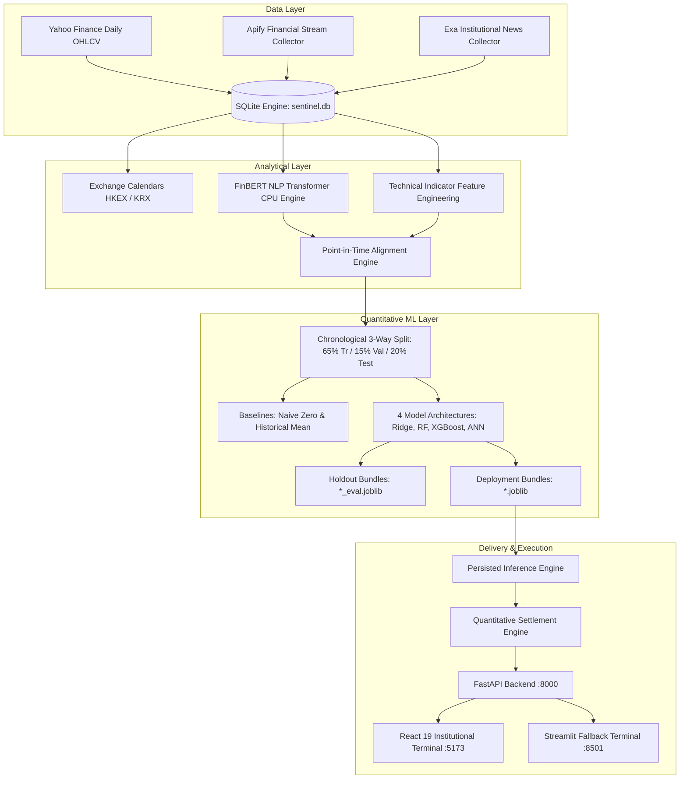

# SENTINEL.AI — Institutional Quantitative Intelligence & ML Systems Terminal

[](https://fastapi.tiangolo.com)
[](https://react.dev)
[](https://www.typescriptlang.org)
[](https://vitejs.dev)
[](https://tailwindcss.com)
[](https://python.org)
[](https://huggingface.co/ProsusAI/finbert)

**SENTINEL.AI** is an institutional-grade financial sentiment intelligence and quantitative predictive analytics terminal covering equities across the **Hong Kong Stock Exchange (HKEX)** and the **Korea Exchange (KRX)**.

The platform integrates real-time institutional financial news, retail and professional financial stream posts, transformer-based financial sentiment analysis (FinBERT), multi-timescale technical indicator engineering, and four machine learning architectures evaluated through strict chronological walk-forward cross-validation.

---

## 1. Architecture Overview



---

## 2. Core Subsystems

### 2.1 Database & Inventory Telemetry
The production SQLite store (`sentinel.db`) strictly holds verified market, news, and discourse records without fabricated data:
- **Historical Market Bars**: 1,245 daily OHLCV bars across 10 tracked equities.
- **Genuine Discourse Posts**: 195 verified financial stream messages (StockTwits cashtags, Apify streams).
- **Curated News Articles**: 135 verified financial news articles with publisher attribution and clean headlines.
- **FinBERT Sentiment Inferences**: 330 point-in-time sentiment inferences with multi-class probabilities.
- **Trained Model Artifacts**: 40 distinct model bundles (4 architectures $\times$ 10 equities).
- **Prediction Forecast Records**: 292 total records persisted with explicit lifecycle statuses:
  - **280 `LEGACY_UNSETTLEABLE`**: Historical records lacking origin prices preserved transparently without fabricating prices.
  - **4 `PENDING_SETTLEMENT`**: Modern predictions with verified origin prices awaiting target session market closes.
  - **8 `INVALID_TARGET_DATE`**: Early development records whose target session dates preceded forecast creation; preserved with audit trail.
  - **0 `SETTLED`**: Zero synthetic settlement outcomes fabricated.

### 2.2 Monitored Equities
- **Hong Kong Stock Exchange (HKEX)** [Currency: HKD, Timezone: Asia/Hong_Kong, Close: 16:00 HKT (08:00 UTC)]:
  - `0700.HK` (Tencent Holdings Ltd - Technology)
  - `9988.HK` (Alibaba Group Holding - Technology)
  - `1299.HK` (AIA Group Limited - Financial Services)
  - `0005.HK` (HSBC Holdings plc - Financial Services)
  - `3690.HK` (Meituan - Consumer Cyclical)
- **Korea Exchange (KRX)** [Currency: KRW, Timezone: Asia/Seoul, Close: 15:30 KST (06:30 UTC)]:
  - `005930.KS` (Samsung Electronics Co., Ltd. - Technology)
  - `000660.KS` (SK Hynix Inc. - Technology)
  - `373220.KS` (LG Energy Solution - Industrials)
  - `005380.KS` (Hyundai Motor Company - Consumer Cyclical)
  - `035420.KS` (NAVER Corporation - Technology)

### 2.2 Data Ingestion & Governance
- **Market Data**: Automated ingestion of open, high, low, close, volume, and adjusted close bars via Yahoo Finance.
- **Social Discourse Streams**: Ingestion of genuine financial social discourse via Apify.
- **Institutional News**: Ingestion of verified financial journalism and wires via Exa.
- **Point-in-Time Guarantees**: Sentiment scores and technical features are matched strictly using timestamps $\le t_{\text{origin}}$, eliminating temporal lookahead bias.

### 2.3 FinBERT Sentiment Inference
- Powered by `ProsusAI/finbert` (Hugging Face).
- Operates on CPU or CUDA via local Hugging Face transformer pipelines.
- Produces normalized positive, negative, and neutral probabilities alongside confidence-weighted sentiment scores in $[-1.0, 1.0]$.
- Model weights (approx. 438 MB) are managed outside Git and installed cleanly via a verified download script.

### 2.4 Quantitative Machine Learning
For each asset and each prediction horizon, SENTINEL AI trains and maintains four architectures:
1. **Ridge Linear Regression**: L2-regularized linear baseline with scaled features.
2. **Random Forest Regressor**: Non-linear ensemble trees controlling variance and overfitting.
3. **XGBoost Regressor**: Gradient-boosted decision trees with shrinkage and subsampling.
4. **Deep MLP Artificial Neural Network**: Multi-layer perceptron with bounded activations and L2 weight regularization.

#### Validation & Baseline Benchmarking
- **Chronological 3-Way Partitioning**: 65% Training, 15% Validation, 20% Untouched Out-of-Sample Test.
- **StandardScaler Discipline**: Scalers are fitted strictly on the training partition and stored inside the deployment artifact bundle.
- **Comparative Benchmarks**: Evaluated on the untouched test partition against:
  - *Naïve Zero-Return Baseline* ($\hat{r}_{t+1} = 0$)
  - *Historical Mean Baseline* ($\hat{r}_{t+1} = \bar{r}_{\text{train}}$)
- **Reported Metrics**: MAE, RMSE, Directional Accuracy (with deadband $\epsilon = 0.001$), Forecast Bias, and Out-of-Sample $R^2$.

### 2.5 Prediction Settlement Lifecycle
- **Forecast Generation**: Records timestamp $t_{\text{pred}}$, target date $t_{\text{target}}$, origin closing price $P_{\text{origin}}$, predicted return $\hat{r}$, and predicted price $\hat{P}$.
- **Target Resolution**: Uses `ExchangeCalendar` to compute next active trading sessions and exact market close datetimes, skipping weekends and official exchange holidays.
- **Quantitative Settlement**: Once the target session bar is ingested:
  $$\text{Actual Return } r = \frac{P_{\text{target}} - P_{\text{origin}}}{P_{\text{origin}}}$$
  $$\text{Prediction Error } = |r - \hat{r}|$$
- **Settlement Idempotence**: Prevents double-settlement and leaves unverified legacy records safely marked as unsettled without fabricating outcomes.

---

## 3. Getting Started

### 3.1 Prerequisites
- Python 3.12+ (64-bit)
- Node.js 18+ & npm
- Git (optional, for repository management)

### 3.2 Installation

1. **Clone or navigate to the repository**:
   ```bash
   cd sentinel-ai
   ```

2. **Set up Python Virtual Environment**:
   ```bash
   python -m venv .venv
   # Windows PowerShell
   .\.venv\Scripts\Activate.ps1
   # Linux/macOS
   source .venv/bin/activate
   pip install -r requirements.txt
   ```

3. **Install Frontend Dependencies**:
   ```bash
   cd frontend-web
   npm install
   cd ..
   ```

4. **Configure Environment Variables**:
   ```bash
   cp .env.example .env
   cp frontend-web/.env.example frontend-web/.env
   ```
   Edit `.env` to provide your credentials (if running live social/news scraping):
   - `APIFY_API_TOKEN` (optional, for live Apify scraping)
   - `EXA_API_KEY` (optional, for live Exa news scraping)

5. **Download FinBERT Transformer Weights**:
   The FinBERT weights (~438 MB) are stored outside source control:
   ```bash
   python sentiment/download_finbert.py
   ```
   This downloads and verifies the model weights with SHA256 checksum validation.

---

## 4. Running the Platform

### 4.1 Start the FastAPI Backend
```bash
.\.venv\Scripts\python.exe -m uvicorn backend.main:app --host 127.0.0.1 --port 8000
```
- API Documentation (Swagger): `http://127.0.0.1:8000/docs`
- Health Telemetry: `http://127.0.0.1:8000/api/status`

### 4.2 Start the React Institutional Terminal
```bash
cd frontend-web
npm run dev
# or preview production build:
npm run build && npm run preview
```
Terminal interface will be accessible at: `http://localhost:5173` (React 19.3.1 + Vite 5.4)

### 4.3 (Optional) Streamlit Fallback Terminal
```bash
.\.venv\Scripts\python.exe -m streamlit run frontend/app.py --server.port 8501
```
Accessible at: `http://localhost:8501`

---

## 5. Automated Testing

Run the full automated test suite covering text sanitation, feature calculation, FinBERT inference, exchange calendars, chronological splitting, model bundle loading, baseline evaluation, and prediction settlement:

```bash
.\.venv\Scripts\python.exe -m pytest tests/test_pipeline.py -v
```

---

## 6. Disclaimers, Settlement Reality & Known Limitations

1. **Unproven Live Performance**: While individual models demonstrate historical validation fits on chronological out-of-sample partitions, **live predictive performance remains unproven until sufficient genuine settled forecasts accumulate over time**. Models must never be considered proven or profitable without an extensive, audited live track record.
2. **Prediction Records Reconciliation & Settlement Reality**:
   - Out of **292 total prediction records** currently stored in `sentinel.db`:
     - **0 are settled** (`settled_at IS NULL` for all 292).
     - **4 are modern pending forecasts** generated with verified market close origin prices ($P_{\text{origin}} = 418.40$ for `0700.HK`), awaiting target session outcome data.
     - **8 are classified as `INVALID_TARGET_DATE`** due to target sessions preceding forecast timestamps; retained for auditability.
     - **280 are legacy development records** generated during prototype iterations prior to the origin-price tracking architecture. These records lack origin prices ($P_{\text{origin}}$ is null) and are **unsettleable**; they are safely retained in the database but will never have artificial origin or target prices fabricated.
3. **Academic and Research Platform**: SENTINEL AI is designed exclusively for quantitative research, sentiment aggregation, and machine learning experimentation. It is **not** an automated trading execution system and does not constitute financial, investment, or trading advice.
4. **Predictive Performance**: Financial time-series contain substantial non-stationary noise. Out-of-sample directional accuracy and errors reported in backtests do not guarantee future performance.
5. **Data Freshness**: Market data ingestion depends on upstream Yahoo Finance feeds. Live trading sessions require active market data provider connectivity.
